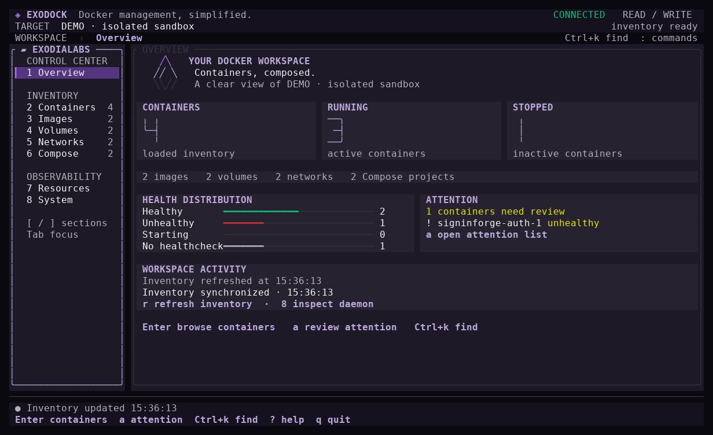
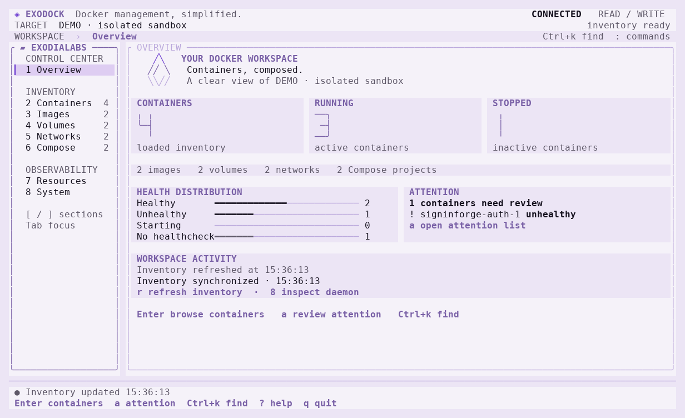
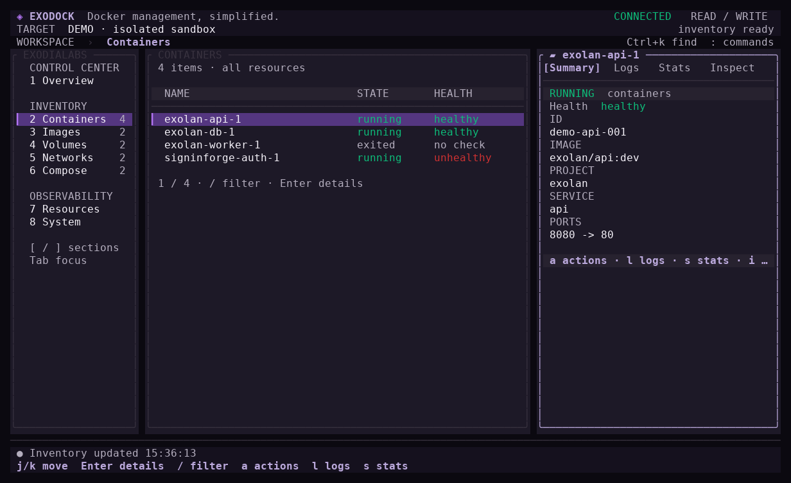

# Interface terminal Exodock

Exodock aide à repérer l'état d'un Docker local, puis à inspecter ou agir sur un
conteneur. La refonte du 13 octobre 2026 organise ce parcours autour d'un tableau
de bord, d'un inventaire et de détails. Les libellés de l'application restent en
anglais ; cette page explique les usages en français.

## Repérer l'état du poste

Le bandeau conserve le nom Exodock, la connexion et le mode `READ ONLY` ou
`READ / WRITE`. La cible Docker reste visible sous le bandeau. Le tableau de
bord `YOUR DOCKER WORKSPACE` présente les nombres de conteneurs actifs et
arrêtés, la répartition de santé et les conteneurs à examiner.

Les surfaces ont des rôles distincts : fond de l'espace de travail, panneaux,
cartes de compteurs et ligne sélectionnée. L'accent violet signale le panneau
actif et la sélection. Les mots `CONNECTED`, `DISCONNECTED`, `running`,
`exited` et les états de santé donnent l'information sans dépendre de la couleur.
Consulter [les couleurs et leur provenance](brand.md) pour les valeurs exactes.

Une erreur de collecte des conteneurs signale une santé inconnue, même si
l'interface conserve un inventaire antérieur. Utilisez `r` pour réessayer avant
de conclure que le poste ne présente aucun problème.

## Naviguer et trouver une ressource

| Touche | Résultat |
| --- | --- |
| `1` à `8`, `[` et `]` | Changer de rubrique |
| `Tab`, `Shift+Tab` | Déplacer le focus entre navigation, inventaire et détails |
| Flèches ou `j` / `k` | Déplacer la sélection dans le panneau actif |
| `Enter` | Ouvrir les détails de la ressource sélectionnée |
| `/` | Filtrer l'inventaire, ou rechercher dans les logs chargés |
| `Ctrl+k` | Chercher dans les ressources déjà chargées |
| `:` | Rechercher une commande dans la palette |
| `Esc` | Fermer une fenêtre ou revenir de la vue de détail |
| `?` | Ouvrir le guide clavier |
| `q`, `Ctrl+c` | Quitter |

Dans la recherche globale et la palette, les résultats apparaissent pendant la
saisie. Les flèches choisissent un résultat ; un seul `Enter` ouvre la ressource
ou lance la commande. Les lettres tapées restent dans le champ de recherche,
y compris `q`, `a`, `j` et `k`. `Esc` annule sans changer la ressource courante.
La recherche porte sur les noms, identifiants, images, projets et services connus.
Elle ne déclenche pas de nouvelle requête Docker.

Dans `Overview`, `a` ouvre les conteneurs qui demandent de l'attention. Dans
`Containers`, `f` parcourt les filtres d'état ; `/` complète ce choix avec une
recherche textuelle. La sélection suit l'identifiant d'une ressource lors d'un
rafraîchissement, même si Docker renvoie l'inventaire dans un autre ordre.

## Inspecter et agir

`l` ouvre les logs, `s` les statistiques et `i` l'inspection. La vue de logs
utilise la largeur disponible pour le texte : `Space` suspend ou reprend le
suivi, `f` revient au direct, `v` change de flux et `t` de période. La recherche
de logs couvre le tampon chargé. Un changement de conteneur annule les lectures
de l'ancien conteneur et rétablit le suivi direct.

`a` ouvre les actions du conteneur sélectionné. Exodock affiche les actions
indisponibles avec leur raison. La confirmation rappelle le nom, l'identifiant
complet et la cible Docker retenus lors de l'ouverture. `CANCEL` est sélectionné
par défaut : `Enter` annule. `Tab` ou les flèches horizontales choisissent
l'acceptation, puis `Enter` confirme. Exodock bloque l'action si le terminal
ne peut pas afficher sa portée complète. Agrandissez la fenêtre ou annulez avec
`Esc`. Un passage sous 60 colonnes ou 18 lignes ferme la confirmation.

En mode `--readonly`, les commandes de modification restent indisponibles.
Une suppression exige un conteneur arrêté ; Exodock ne propose ni suppression
forcée ni action globale de nettoyage.

## Adapter l'affichage

L'interface conserve les commandes à partir de 60 × 18 cellules. Les grands
terminaux affichent navigation, inventaire et détails côte à côte ; les tailles
intermédiaires privilégient le panneau courant. Une vue de logs ou d'inspection
ouverte dispose d'une zone élargie. Les fenêtres de recherche et de confirmation
se centrent au-dessus de l'espace de travail. Sous la taille minimale, Exodock
affiche une instruction de redimensionnement et garde la commande de sortie.

`--theme dark`, `--theme light` et `--theme auto` choisissent le thème. Le thème
automatique utilise la réponse du terminal sur son fond ; sans réponse, Exodock
conserve le thème sombre. Le terminal décide de la police et de la précision
des couleurs. `--ascii` remplace les cadres et symboles Unicode. `--no-color`
ou la variable `NO_COLOR` suppriment les couleurs tout en conservant les textes
d'état, les indicateurs de sélection et de focus.

`--reduced-motion` supprime les animations de démarrage et de chargement. La
préférence JSON correspondante est `reduced_motion`. Sans cette option, les
animations restent brèves au démarrage et accompagnent les opérations en cours ;
Exodock ne programme pas de boucle d'animation au repos. Le mode sans couleur
supprime aussi ces animations.

## Vérifier les changements

Captures du backend de démonstration, le 13 octobre 2026 :

Les tests Go couvrent les dimensions, les thèmes, les cadres ASCII, les champs
de recherche et les confirmations. Les parcours PTY utilisent le backend de
démonstration : ils contrôlent les raccourcis, les couleurs sombres et claires,
le redimensionnement et la restitution du terminal après une sortie ou un signal.
Les benchmarks conservent 10 000 lignes de logs et mesurent aussi le rendu couleur
avec un inventaire de 1 000 conteneurs. Les commandes figurent dans
[le guide de développement](development.md) ; les limites de plateforme restent
celles du [périmètre MVP](mvp.md).
